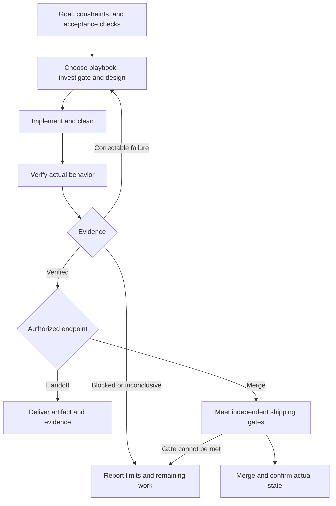

**I completed the three passes. The central explanation held up, but the audit found omitted mandatory steps and several places where I compressed conditional workflows too far. I’ve corrected those and rewritten the explanation below.**

## Audit result

I anchored the review to the official repository at [commit `536a3352a050e47cb75f86be497ea304ef342301`](https://github.com/cursor/plugins/commit/536a3352a050e47cb75f86be497ea304ef342301), checked 46 source-file copies against their Git blob hashes, and checked the relevant Cursor platform documentation.

| Pass | What I checked | Outcome |
|---|---|---|
| **Verification** | The claims in every section against the relevant skills, playbooks, agent definitions, and documentation. | The core descriptions were supported. Several operative requirements and limitations were missing. |
| **Confirmation** | Seventeen documented workflow paths, including their handoffs, exceptions, and stopping points. | The overall model was consistent, but the diagram needed a blocked-work exit and clearer separation of optional activities. |
| **Fact-check** | The complete explanation and proposed corrections, including source inconsistencies, overstatements, and possible overcorrections. | The corrections below are supported. Some statements needed qualification rather than reversal. |

**This establishes what the inspected source instructs agents to do. Actual execution in your installed Cursor environment remains unverified:** I did not launch the plugin there, run its subagents, exercise its application controls, or perform real PR, CI, or merge operations.

### What needed correction or qualification

| Area | Correction |
|---|---|
| **Delegation and Arena** | Delegation follows the selected playbook. Feature implementation requires delegation, and multiple valid implementation shapes trigger mandatory Arena comparison. My opening made delegation sound more discretionary. |
| **Design and planning** | Architect explicitly considers two shapes, with Arena escalation for large or contested designs. A requested multi-phase plan is a separate deliverable with specific verification obligations and an execution stop. |
| **Comment cleanup** | `/no-comments` can remove comments and cause accepted code repairs within scope. It is more active than my description conveyed. Constraint encodings have their own approval requirements. |
| **Verification coverage** | Generating an application-verification skill proves its procedure on **one mapped feature**. That does not establish full application coverage. Formal checks also require demonstrating that they detect an intentionally broken variant. |
| **PR and autopilot timing** | Autopilot-full opens a PR early so CI overlaps the work. Autopilot-stack stops at verified, green PRs and prohibits further pushes after handoff without the operator’s go. |
| **The diagram and learning** | Failed or inconclusive work can end in an explicit limitation report. Reflect and Correct are separate invoked workflows; they are not an automatic final stage after every task. |

These corrections follow the operative feature, planning, cleanup, verification, autopilot, and reflection instructions. [GitHub](https://github.com/cursor/plugins/blob/main/pstack/skills/poteto-mode/playbooks/feature.md?utm_source=chatgpt.com)

---

# Corrected end-to-end explanation of PSTACK

## 1. What PSTACK is

**PSTACK is an opinionated, instruction-driven engineering workflow for Cursor.** Its main entry point, `/poteto-mode`, tells the receiving agent how to organize a task: establish the goal, select a suitable playbook, apply the relevant engineering principles, delegate according to that playbook, verify the outcome, and report the evidence.

The user supplies the desired result and constraints. The agent takes responsibility for organizing the engineering work needed to reach that result. That is the intended division of responsibility described in the guide. [github.com](https://github.com/cursor/plugins/blob/main/pstack/docs/guide/README.md?utm_source=chatgpt.com)

A useful way to understand its parts is:

| Part | Function |
|---|---|
| **`/poteto-mode`** | Coordinates the task and selects its workflow. |
| **Playbooks** | Define how particular kinds of work proceed. |
| **Skills** | Supply focused methods for investigation, design, comparison, review, verification, and writing. |
| **Agent definitions** | Give certain delegates their role-specific instructions. |
| **Verification procedures and helpers** | Let agents exercise the project and collect evidence. |
| **Engineering principles** | Guide choices about complexity, ownership, scope, and proof. |

This table is an explanatory model of the package. Cursor supplies the underlying agent, model, tools, and execution environment. Its documentation describes agents as a combination of instructions, tools, and a model; PSTACK supplies additional instructions and workflows for that system to follow. [Cursor Docs](https://cursor.com/docs/agent/overview?utm_source=chatgpt.com)

That distinction matters when evaluating it: reading PSTACK’s source establishes its prescribed behavior. Observing an actual run is necessary to establish whether a particular agent followed those prescriptions.

## 2. Installation, configuration, and activation are separate

The documented Cursor setup begins with:

```text
/add-plugin pstack
/setup-pstack
```

Setup attempts to identify available models, asks for a reasoning budget, presents the model assignment for each role, and validates the selected model identifiers before writing the configuration. If it cannot determine availability, its instructions call for asking the user for the available identifiers.

The configuration is written to `~/.cursor/rules/pstack-models.mdc`. It applies to new sessions, so the guide directs the user to start a new chat afterward. [github.com](https://github.com/cursor/plugins/blob/main/pstack/skills/setup-pstack/SKILL.md?utm_source=chatgpt.com)

Setup also makes two separate optional offers when the project lacks the corresponding capability:

- Generate a procedure for driving the application and proving observable behavior.
- Generate a procedure for checking a particular property with formal-verification tools or an appropriate alternative.

Accepting those offers starts additional work. Setup does not automatically provide every external control tool, dependency, or usable application environment. [github.com](https://github.com/cursor/plugins/blob/main/pstack/docs/guide/01-setup.md?utm_source=chatgpt.com)

**Installing the plugin does not automatically activate its whole workflow.** Ordinary invocation attaches `/poteto-mode` to a message. Using the skill as a Cursor Custom Mode keeps it in context on subsequent turns until the mode is exited. Cursor documents Option+Enter on Mac and Alt+Enter on Windows, or **Use as Mode**, for that persistent activation. [Cursor Docs](https://cursor.com/docs/agent/prompting?utm_source=chatgpt.com)

## 3. A request becomes a specific playbook

You normally describe the outcome and how to check it.

For example, this would be a suitable **hypothetical** request:

```text
/poteto-mode saved filters disappear after restarting the app.
Reproduce the problem, identify the cause, and fix it.
Done means a saved filter survives restart and can still be edited.
Show the before-and-after behavior.
Do not merge the change.
```

The useful ingredients are the goal, acceptance check, requested evidence, relevant facts, and constraints. The guide encourages leaving the agent room to choose the method instead of prescribing a long sequence of skills. [github.com](https://github.com/cursor/plugins/blob/main/pstack/docs/guide/02-poteto-mode.md?utm_source=chatgpt.com)

`/poteto-mode` selects the relevant playbook and copies its steps into the task list. Its available routes cover investigations, bugs, features, refactoring, performance work, prototypes, profiling analysis, visual equivalence, planning, PR management, shipping, autonomous work, and continuity between sessions. [raw.githubusercontent.com](https://raw.githubusercontent.com/cursor/plugins/main/pstack/README.md?utm_source=chatgpt.com)

The route determines both the work and the stopping point:

| Requested work | Expected outcome |
|---|---|
| Investigate or explain | Supported findings or a recommendation. |
| Produce a multi-phase plan | A plan with dependencies and verification obligations, followed by a stop. |
| Fix, build, or refactor | An implemented change with the required verification and delivery steps. |
| Review a change | Findings supported by the applicable review procedure. |
| Check or babysit a PR | A status report or progress toward merge-ready, according to the requested mode. |
| Ship authorized work | Verified landing, followed by confirmation of actual merge state. |
| Work autonomously | Continued execution toward an explicit finish condition, with recorded progress and defined limits. |

For example, the Investigation playbook explicitly excludes code changes, PR creation, and babysitting. Its cited explanation is the deliverable. [github.com](https://github.com/cursor/plugins/blob/main/pstack/skills/poteto-mode/playbooks/investigation.md?utm_source=chatgpt.com)

A requested Multi-phase plan also stops before implementation. It specifies dependencies and unit, live, and performance verification obligations for proposed PRs; interaction-changing PRs require operator review before merge. For an obvious one- or two-file change, that playbook says to explain that a plan is unnecessary and stop. [github.com](https://github.com/cursor/plugins/blob/main/pstack/skills/poteto-mode/playbooks/multi-phase-plan.md?utm_source=chatgpt.com)

## 4. It establishes evidence before choosing a repair

PSTACK distinguishes understanding current behavior from understanding historical intent.

- **`/how`** traces the implementation.
- **`/why`** researches the record behind design decisions.
- **`/teach`** develops an explanation using behavior and rationale.
- **`/recall`** reconstructs relevant prior working context.

The historical route is expected to distinguish what authors actually recorded from the agent’s inference, and to acknowledge unanswered questions. [github.com](https://github.com/cursor/plugins/blob/main/pstack/docs/guide/03-understand.md?utm_source=chatgpt.com)

For a bug, the workflow is more concrete:

1. Reproduce the problem on the affected interface.
2. Develop competing explanations.
3. Use runtime evidence to eliminate them.
4. Confirm the surviving mechanism.
5. Delegate the repair.
6. Repeat the original reproduction on the same interface.

Instrumentation is appropriate when the running state is unclear. Changes motivated by a disproven explanation are supposed to be reverted. The final account connects the observed failure, its cause, the repair, and the evidence that the original failure is gone. [github.com](https://github.com/cursor/plugins/blob/main/pstack/skills/poteto-mode/playbooks/bug-fix.md?utm_source=chatgpt.com)

Performance work has a different starting point: a measured baseline. Its playbook prioritizes removing unused work, avoiding repeated work, reducing or deferring work, and then considering other improvements. The agent captures comparable results and vets the numbers before reporting a gain. It should stop once an earlier, simpler intervention meets the target. [github.com](https://github.com/cursor/plugins/blob/main/pstack/skills/poteto-mode/playbooks/perf-issue.md?utm_source=chatgpt.com)

The common requirement is that the explanation for a change should follow evidence about the system.

## 5. Design happens before implementation locks in a shape

For work crossing a function boundary, `/architect` examines the affected systems and sketches **two different shapes** involving types, signatures, and module boundaries.

Its criteria include clear ownership of state, a clear supported way to perform each task, and a small amount of knowledge required from callers. Large or contested designs escalate to Arena. Repeated workarounds are a reason to reconsider the architecture. [github.com](https://github.com/cursor/plugins/blob/main/pstack/skills/architect/SKILL.md?utm_source=chatgpt.com)

An empirical uncertainty should be investigated with something executable when practical. The Prototype playbook can build a small disposable version, exercise it, and collect the evidence needed to decide. That can apply to UI behavior, algorithms, or other design questions. [github.com](https://github.com/cursor/plugins/blob/main/pstack/docs/guide/04-design.md?utm_source=chatgpt.com)

There are **two distinct Arena triggers** to keep straight:

- Architect escalates a large or contested design to Arena.
- The Feature playbook independently requires Arena when implementation still admits multiple valid shapes, such as different error-handling approaches, abstractions, or test structures.

The latter is an explicit requirement, with a documented accommodation for a worker prohibited from spawning children. It is not merely an optional request for extra scrutiny. [GitHub](https://github.com/cursor/plugins/blob/main/pstack/skills/poteto-mode/playbooks/feature.md?utm_source=chatgpt.com)

Large or unattended execution is also distinct from a requested written plan. `/figure-it-out` designs a workflow for the execution: it establishes the completion condition, scope, risk, verification infrastructure, units of work, and decision trail before proceeding. [github.com](https://github.com/cursor/plugins/blob/main/pstack/skills/figure-it-out/SKILL.md?utm_source=chatgpt.com)

## 6. Delegation preserves ownership

The main chat owns the selected playbook and remains accountable for the result. Delegation does not transfer that responsibility.

The mode requires worker instructions to be passed explicitly in the kickoff. Direct `poteto-agent` delegates also receive the main skill’s path. Fresh delegates are generally preferred for retries and follow-ups, with exceptions when a running process, checkout, or other costly-to-transfer state needs to remain with the existing worker. [raw.githubusercontent.com](https://raw.githubusercontent.com/cursor/plugins/main/pstack/skills/poteto-mode/SKILL.md?utm_source=chatgpt.com)

Before feature implementation, the lead records four checkpoint items:

1. Prerequisites.
2. Independent workstreams.
3. Shared mutable state.
4. The smallest safe decomposition.

These are recorded todos, including explanations for nonapplicable items, and are refreshed at phase boundaries. Coupled implementation has one owner; parent-level parallelism is reserved for independently deliverable artifacts. [GitHub](https://github.com/cursor/plugins/blob/main/pstack/skills/poteto-mode/playbooks/feature.md?utm_source=chatgpt.com)

The worker contract also constrains unnecessary process expansion. Workers are instructed to meet the assigned bar without adding extra gates or review rounds. They should distinguish problems introduced by the work from problems already present in the base. [github.com](https://github.com/cursor/plugins/blob/main/pstack/skills/poteto-mode/worker.md?utm_source=chatgpt.com)

## 7. Arena, Swarm, and Interrogate solve different coordination problems

### Arena compares solutions

Arena gives multiple agents the same task in isolated output locations. The coordinator evaluates their artifacts against a rubric, selects a base, incorporates worthwhile ideas from alternatives when appropriate, and verifies the synthesized result.

It normally seeks a judge from a different vendor than the parent’s model. Availability problems or an unknown parent model can limit that check, and the limitation must be disclosed. Model diversity is therefore a configured method with fallbacks, not a universal guarantee.

If the candidates converge, unnecessary synthesis is avoided. If they diverge because the task was poorly framed, the instructions call for reframing and rerunning. [github.com](https://github.com/cursor/plugins/blob/main/pstack/skills/arena/SKILL.md?utm_source=chatgpt.com)

### Swarm distributes coverage or runs a declared race

Swarm assigns independent slices, identical-brief races, or a mixture. It establishes the completion and selection rules before launching workers.

When workers verify commits, their briefs identify the exact revisions. Measurement work also specifies the method. The coordinator aggregates evidence, reports dropouts, and preserves missing coverage as a gap.

A race may still finish under its declared selection rule while reporting dropouts. That is different from treating an unchecked required coverage slice as a pass. [github.com](https://github.com/cursor/plugins/blob/main/pstack/skills/swarm/SKILL.md?utm_source=chatgpt.com)

### Interrogate challenges correctness

Interrogate gives adversaries a change and its intended behavior. Each alleged defect needs an actual run demonstrating the failure.

The coordinator reruns findings, retains demonstrated violations of intent, drops unsupported claims, and consolidates shared causes. It returns findings without applying fixes. A result with no verified findings is valid, although it does not establish that no bugs exist. [github.com](https://github.com/cursor/plugins/blob/main/pstack/skills/interrogate/SKILL.md?utm_source=chatgpt.com)

| Workflow | Main question |
|---|---|
| **Arena** | Which implementation or design should we build from? |
| **Swarm** | Have we covered the required work, or which attempt satisfies the declared selection rule? |
| **Interrogate** | What can we demonstrate is wrong with this change? |

## 8. Implementation includes testing and cleanup

The code-producing workflows aim for small units that can be built, checked, and committed in sequence.

Test-first work is conditional. `/tdd` is appropriate when requested or when a bug has a clear, inexpensive local test path. The test should fail for the intended reason before the fix and pass afterward. If the test would require brittle mocks or extensive unrelated setup, the workflow calls for a practical executable check instead of waiving verification. [github.com](https://github.com/cursor/plugins/blob/main/pstack/docs/guide/05-build-and-clean.md?utm_source=chatgpt.com)

Cleanup has separate responsibilities:

- **`/deslop`** addresses unnecessary material in the code diff and comes from **cursor-team-kit**.
- **`/unslop`** addresses prose.
- **`/no-comments`** performs a separate comment-focused pass.

The mode routes Deslop before commits and No-comments before review. [raw.githubusercontent.com](https://raw.githubusercontent.com/cursor/plugins/main/pstack/skills/poteto-mode/SKILL.md?utm_source=chatgpt.com)

The comment pass deserves a precise description. Comment Sicko may edit comments and identify code that needs attention; it does not edit application code itself. The parent audits its output and implements accepted repairs within the assigned scope.

Proposals to encode a stated constraint as a type, runtime check, test, or lint have an explicit approval or preapproval requirement. Unenforced constraints and unresolved work must be reported. This is an editing-and-repair workflow, not merely advisory feedback. [GitHub](https://github.com/cursor/plugins/blob/main/pstack/skills/no-comments/SKILL.md?utm_source=chatgpt.com)

## 9. Verification establishes a particular outcome within a particular scope

PSTACK’s proof principle calls for checking the actual artifact or behavior. A successful build, cached output, or another agent’s assurance cannot substitute for the relevant observation. A repeatable check is preferred where practical. [github.com](https://github.com/cursor/plugins/blob/main/pstack/skills/principle-prove-it-works/SKILL.md?utm_source=chatgpt.com)

For the hypothetical saved-filter task, the meaningful check would involve saving a filter through the application, restarting, recovering it, and editing it. A serialization-helper test could contribute evidence while leaving parts of that journey unchecked.

### Application-verification skills

`/create-verification-skill` builds a repository-specific procedure covering launch, readiness, interaction, evidence, cleanup, and a feature map.

Before handoff, it must execute that procedure end to end on **one mapped feature** and verify that the evidence survives cleanup. This proves that demonstrated procedure. It does not prove every feature in the map.

If the run uses a substitute environment, setup behavior supplied only by that substitute remains unverified for the real target. Subsequent task-specific verification and maintenance address further coverage and drift. [github.com](https://github.com/cursor/plugins/blob/main/pstack/skills/create-verification-skill/SKILL.md?utm_source=chatgpt.com)

### Formal checks and their limits

The formal-verification workflow selects a consequential property, an appropriate tool, and explicit assumptions and bounds. Its model or proof must correspond to the actual implementation.

It must also demonstrate that the checking procedure catches an intentionally broken variant. A passing check that has never demonstrated sensitivity to the defect class is insufficient for handoff.

When no suitable code verifier supports the language, the workflow permits generated-input testing against real code. That fallback is empirical testing; it should not be described as exhaustive formal proof. [GitHub](https://github.com/cursor/plugins/blob/main/pstack/skills/create-formal-verification-skill/SKILL.md?utm_source=chatgpt.com)

Across these routes, the key distinction is between an observed result and the larger claim someone might be tempted to infer from it. Missing or inconclusive required evidence remains a limitation. Different skills use different status labels, but they should not silently promote a gap into success.

## 10. PR creation, PR management, and merging have different authority

### Opening a PR

The normal PR-opening workflow isolates the work, arranges small commits, cleans the diff, and creates a ready-for-review PR with a concise explanation and verification information.

Opening it does not automatically start Babysit. A PR being marked ready for review also does not establish that every later acceptance or shipping gate has passed. [github.com](https://github.com/cursor/plugins/blob/main/pstack/skills/poteto-mode/playbooks/opening-a-pr.md?utm_source=chatgpt.com)

### Babysitting

Babysit has modes for a single status check, review-thread work, or driving toward merge-ready.

It evaluates bot findings against the code and handles real failures. Standalone Babysit reports a conflict or required rebase rather than rebasing, retargeting, or force-pushing itself. It does not grant merge authority. [github.com](https://github.com/cursor/plugins/blob/main/pstack/skills/poteto-mode/playbooks/babysit.md?utm_source=chatgpt.com)

### Shipping

Shipping requires verification by an agent that did not write the change. The verifier exercises the relevant behavior and compares parent against head. This is independence of authorship; it does not mean every shipping verifier must use another model vendor.

Dependent stacks land from the bottom through the contiguous verified portion. A higher PR cannot bypass an unverified dependency.

Evidence also has to remain applicable to the patch being merged. A changed commit identifier does not automatically invalidate every previous result, but changed behavior can require renewed checks. The process reads back actual merge state because a queued merge is not yet a completed merge. [github.com](https://github.com/cursor/plugins/blob/main/pstack/skills/poteto-mode/playbooks/shipping.md?utm_source=chatgpt.com)

A completed code task therefore needs both the requested deliverable and an honest account of its verification. “Implemented” alone should not be presented as verified completion.

## 11. Autonomous work adds explicit completion criteria and supervision

For long-running work, `/figure-it-out` creates an auditable sequence of phases. It places risky unknowns and baseline verification early, isolates independent work, and treats each unit as an experiment.

The loop is to make a justified change, check it against the goal, keep useful progress, discard unsuccessful changes, and record the decision. The final check returns to the original goal on the real product. [github.com](https://github.com/cursor/plugins/blob/main/pstack/skills/figure-it-out/SKILL.md?utm_source=chatgpt.com)

Cursor’s built-in `/loop` supplies repeated execution or wake-ups. It is a platform capability, not a separate PSTACK scheduling engine. [Cursor Docs](https://cursor.com/docs/agent/overview?utm_source=chatgpt.com)

An unattended handoff should define the finish condition, permissions, workspace, decision trail, and genuine-blocker conditions. The run should not lower its acceptance condition to manufacture success. A correctable problem calls for another justified attempt; a genuine dead end calls for an explicit report. [github.com](https://github.com/cursor/plugins/blob/main/pstack/docs/guide/07-overnight.md?utm_source=chatgpt.com)

### Autopilot-full

Autopilot-full assigns one owner to each independent PR. The owner carries that PR through implementation and delivery, while the root owns independent verification verdicts.

It deliberately opens PRs early so CI and review bots overlap the work. Finished code receives the full verification swarm. Major later changes can require another full swarm; smaller fixes or rebases use narrower reverification. Every new head still needs the relevant green CI.

Its merge grant applies to the specified queue, and the playbook preserves durable progress and monitors stalled agents. [github.com](https://github.com/cursor/plugins/blob/main/pstack/skills/poteto-mode/playbooks/autopilot-full.md?utm_source=chatgpt.com)

### Autopilot-stack

Autopilot-stack uses the same general machinery with a different endpoint:

- Each PR is verified and green at its current head.
- PRs are handed to the operator without merging.
- After handoff, further pushes require the operator’s go.
- A PR is stacked only when it actually depends on another PR.

That final push restriction belongs to this workflow; it is not a universal rule for every ordinary PR handoff. [GitHub](https://github.com/cursor/plugins/blob/main/pstack/skills/poteto-mode/playbooks/autopilot-stack.md?utm_source=chatgpt.com)

### Pausing and resuming

An explicit pause stops at a safe boundary, preserves a checkpoint, and leaves information a new session can use. Session pickup reconstructs the operational state, preserves completed investigation, identifies the remaining work, and checks inherited claims against the actual goal and artifact.

The intent is continuity without blindly trusting a previous success report or restarting the entire investigation. [github.com](https://github.com/cursor/plugins/blob/main/pstack/docs/guide/03-understand.md?utm_source=chatgpt.com)

## 12. Learning has both in-task and separately invoked forms

Specific workflows and principles call for recurring corrections to become structural protections: a better boundary, type, check, or reusable tool. That can happen as part of the work itself.

Separately, PSTACK provides named improvement workflows.

**`/reflect`** examines the session for durable lessons and proposes changes to skills. It waits for approval before editing an appropriate local or project copy and explicitly does not push or open a PR. [GitHub](https://github.com/cursor/plugins/blob/main/pstack/skills/reflect/SKILL.md?utm_source=chatgpt.com)

**`/correct`** investigates recurring mistake classes in the repository. It favors preventing the mistake through architecture or types, then automated checks and tests, with written reminders used for judgment that cannot be enforced. New protections are checked against real past mistakes. [github.com](https://github.com/cursor/plugins/blob/main/pstack/docs/guide/09-make-it-yours.md?utm_source=chatgpt.com)

These are concrete changes to instructions, code, or tooling. They are not automatic training of the underlying model, and Reflect is not an automatic terminal stage after every task.

## 13. The corrected workflow picture

For **code-producing work**, the acceptance flow can be summarized like this:



This diagram shows acceptance and handoff relationships. It does not prescribe the timing of every activity: Autopilot-full, for example, creates its PR while implementation and verification work are still progressing. Investigation-only and plan-only requests have their own earlier endpoints. Named reflection workflows are separate.

## What I would tell someone evaluating PSTACK

PSTACK’s defining behavior is **structured ownership with explicit evidence**. It directs an agent to choose a method appropriate to the task, preserve clear responsibility when delegating, and distinguish producing an artifact from demonstrating that it meets the goal.

Its benefit is an intended working discipline. Its tradeoff is additional coordination, model calls, and sometimes competing implementations or review passes. Model assignments, reasoning budgets, and panel sizes provide ways to adjust that expenditure. [github.com](https://github.com/cursor/plugins/blob/main/pstack/skills/poteto-help/SKILL.md?utm_source=chatgpt.com)

The source also contains some inconsistent shorthand. For example, the generic PR-opening description says it follows other playbooks, while Investigation explicitly prohibits creating a PR; some guide text calls the comment agent read-only, while the operative workflow permits comment edits. The account above follows the more specific task and agent instructions rather than treating every summary sentence as universally applicable. [github.com](https://github.com/cursor/plugins/blob/main/pstack/skills/poteto-mode/playbooks/opening-a-pr.md?utm_source=chatgpt.com)

**The accurate promise is a prescribed engineering process that aims to make autonomous work inspectable and accountable.** Whether a particular installation delivers that behavior must be judged from its actual artifacts, tool runs, verification evidence, and adherence to the requested scope.